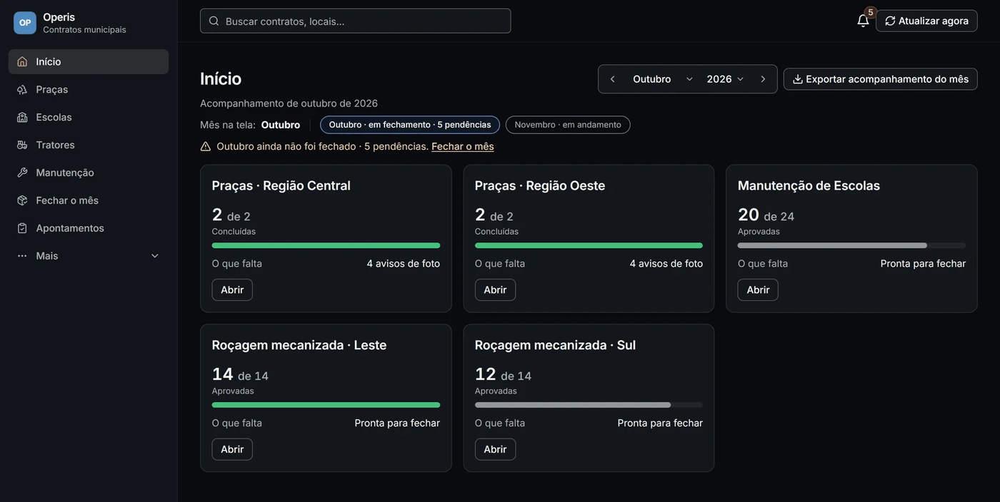
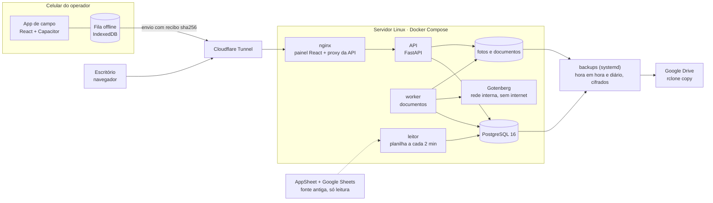
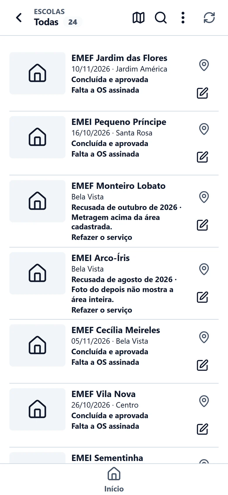
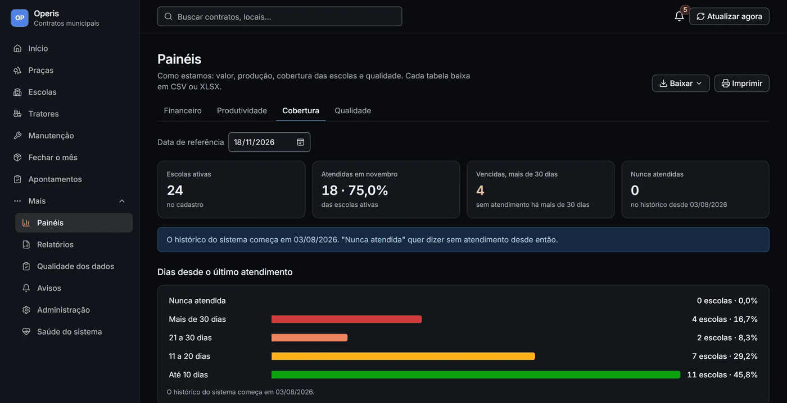

# Operis · gestão de contratos de serviços

Sistema de gestão dos contratos de serviços com o poder público (manutenção de escolas, praças e roçagem com trator): a equipe registra o serviço no celular, o escritório confere, o mês fecha e os documentos de medição saem prontos.

**Produto:** [theblack.com.br/operis](https://theblack.com.br/operis)

> O código é privado (projeto de cliente). Este repositório documenta o projeto.

Imagem da página pública do produto, com dados de exemplo.

## Problema

Todo mês cada contrato precisa ser medido e entregue com um pacote de documentos: medição, ofício, relatório fotográfico, diário, planilhas. Antes, a coleta era feita num app AppSheet e o resto vivia em Google Sheets, Apps Script e Drive. A planilha mudava depois da entrega, havia números digitados à mão e os documentos saíam com erros que só apareciam na conferência.

## Solução

Uma plataforma própria em três partes: **app de campo** (Android e navegador) para registrar cada serviço com fotos de antes e depois, GPS e horário; **painel web** para o escritório avaliar, fechar o mês e gerar os documentos; e uma **API** que é a fonte da verdade, com regras de medição, auditoria e geração de PDF, XLSX e DOCX. A migração do AppSheet foi gradual: enquanto o app próprio era validado, um leitor importava a planilha para o banco sem parar a operação.

O produto foi desenhado para ser vendido a outras empresas: nome, logo, preços, textos e feriados são configuração, não código. Cada empresa tem a sua instalação.

## Funcionalidades principais

- **App de campo:** serviços do dia por módulo, registro com fotos (câmera ou galeria), localização, ordem de serviço, mapa e caminho até o local; serviço recusado volta para o celular de quem fez, com o motivo.
- **Avaliação:** o escritório aprova, devolve ou recusa cada execução e cada foto, com motivo registrado.
- **Fechamento do mês:** lista do que falta (foto, data, ordem assinada) antes de fechar; mês fechado fica travado e só reabre com motivo.
- **Documentos:** medição, ofícios, relatório fotográfico, diário e planilhas gerados a partir do fechamento, em PDF, XLSX e DOCX.
- **Painéis:** financeiro, produtividade, cobertura (dias desde o último atendimento) e qualidade; qualquer tabela exporta em CSV ou XLSX.
- **Frota e manutenção:** inspeção, notas fiscais, orçamentos, autorizações e peças dos tratores.
- **Acesso por papel:** administrador, supervisor, operador de campo e leitura; módulos liberados por usuário.
- **Saúde do sistema:** versão no ar, fila de documentos, leitor, backup e tempo da foto até o recibo do servidor.

## Arquitetura

A mesma imagem da API roda a API, o worker, o leitor e as migrações. O ambiente real e o ambiente de teste do app têm bancos separados na mesma VM: dado de teste nunca entra no banco real, nem o contrário.

## Decisões técnicas e desafios

1. **Fila offline no app de campo, com recibo.** Foto e registro entram numa fila no IndexedDB e só saem do celular quando o servidor devolve um recibo com o mesmo sha256. Reenviar é seguro porque o servidor é idempotente pelo hash. As tentativas esperam cada vez mais, uma foto com problema não segura as outras e o envio paralelo sobe de 2 para 3 quando a conexão medida está boa. *Por quê:* no campo o sinal é ruim, e foto de serviço não pode se perder.
2. **Mês fechado não muda.** Há uma medição por contrato e mês; fechada, ela fica travada, e reabrir exige motivo e fica na auditoria. Dado de negócio nunca é apagado: muda de estado (arquivado, cancelado, substituído). *Por quê:* o documento entregue precisa continuar batendo com o banco meses depois.
3. **Teste de ouro dos documentos.** Os documentos gerados são comparados, nos testes, com documentos já aprovados. A geração roda num worker, e o Gotenberg (Chromium e LibreOffice) fica numa rede interna sem saída para a internet, com JavaScript desligado e download externo bloqueado. *Por quê:* o requisito número um era o documento bater centavo a centavo com o aprovado.
4. **AppSheet como adaptador, não como núcleo.** Tudo o que é específico do AppSheet fica num pacote isolado; o núcleo usa nomes neutros e um campo de origem. O leitor só lê a planilha (a única escrita permitida é uma aba de devoluções). *Por quê:* deu para trocar o app de coleta pelo app próprio sem reescrever as regras de medição.
5. **Subida com volta automática.** O script de atualização confere o servidor, faz backup do banco, troca a versão e testa o `/health` e a migração; se algo falhar, volta código e imagens para a versão anterior. O app Android recebe atualização do código web sem reinstalar, e um script avisa antes da subida quando a mudança exige reinstalar o APK.
6. **Backup que se prova.** Banco copiado de hora em hora e todo dia, cifrado com gpg antes de ir para o Google Drive; fotos endereçadas por sha256 e enviadas de forma incremental com `rclone copy` (nunca `sync`). Todo domingo um timer restaura o último backup num banco de ensaio e compara a contagem de linhas com o banco real. *Por quê:* backup que não restaura não vale nada.

## Stack

| Parte | Tecnologias |
|---|---|
| API | Python 3.12, FastAPI, Uvicorn, SQLAlchemy 2, Alembic, Pydantic Settings, JWT (python-jose), bcrypt |
| Documentos | Jinja2, openpyxl, pypdf, Pillow, Gotenberg 8 |
| Banco | PostgreSQL 16 |
| Painel | React 18, Vite, TypeScript, Tailwind CSS 4, shadcn/ui (Radix), React Router, Leaflet, pdf.js |
| App de campo | React 18, TypeScript, Capacitor 6 (câmera, arquivos, compartilhar), Capgo updater, IndexedDB, Leaflet |
| Testes | pytest (com xdist), Vitest, Playwright, axe-core; ruff |
| Infra | Docker Compose, nginx, Cloudflare Tunnel, systemd timers, rclone, gpg |

## Telas

  

Imagens da página pública do produto ([theblack.com.br/operis](https://theblack.com.br/operis)), com dados de exemplo. As telas do sistema em uso, com dados reais, não são mostradas aqui.

## Meu papel

Projeto, desenvolvimento e implantação.
